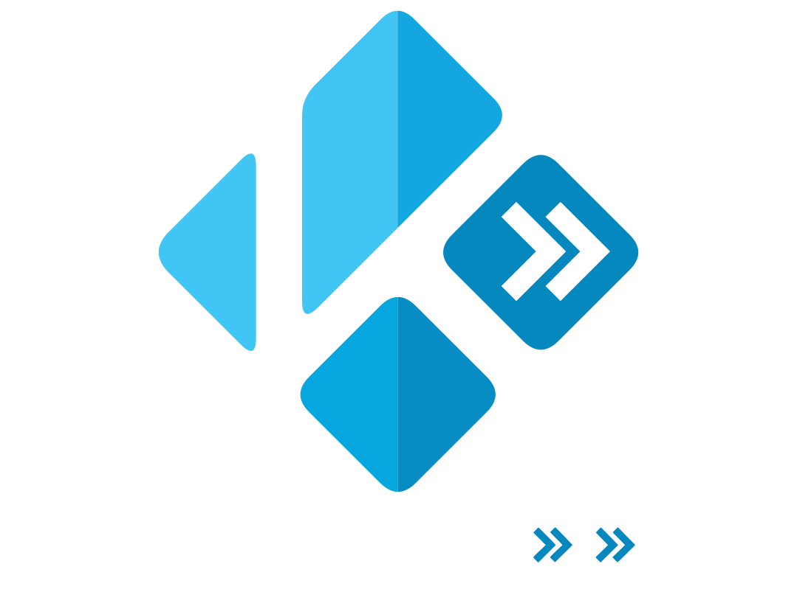

# Kodi Intro Skipper

<div align="center">
    <p>
        
    </p>
    <p>
        Standalone intro and credit detection daemon and native Kodi add-on.
    </p>
</div>

> [!NOTE]
> ### Origin & Acknowledgements
> This project is a standalone fork of [intro-skipper/intro-skipper](https://github.com/intro-skipper/intro-skipper), originally created and maintained by the IntroSkipper team for Jellyfin.
>
> It refactors the multi-episode audio fingerprinting (Chromaprint), chapter analysis, black-frame detection, and keyframe credit analysis pipelines into a standalone, lightweight daemon (`IntroSkipper.Server`) and pairs it with a native Kodi service add-on (`service.introskipper`) for playback skipping without requiring Jellyfin.
>
> All original detection algorithms, database schemas, and analyzers remain licensed under the [GNU General Public License v3.0](LICENSE).

---

## Features

- **Native Kodi OSD Skip Button**: A sleek, non-blocking on-screen overlay displayed during intro and credits scenes.
- **Dynamic Circular Countdown**: Starts with a full circular progress ring and smoothly drains to an empty ring as the intro plays, alongside a remaining seconds countdown.
- **Remote & Mouse Friendly**: Press **Select / OK** on your remote or click to skip immediately; press **Back** to dismiss.
- **Configurable Actions**: Choose between **Prompt (Skip Button)**, **Automatically Skip**, **Play Next Episode** (credits), or **Disabled**.
- **Kodi `sources.xml` Integration**: Select and trigger scans directly from your configured Kodi video sources inside the add-on UI.
- **Standalone Daemon**: Fast REST API with a local SQLite database (`introskipper.db`), running independently as a service on your Kodi box, NAS, or home server.

---

## Kodi Add-on (`service.introskipper`)

The Kodi add-on runs as a background service during playback and provides a management interface from the Add-ons menu.

### Installation
Copy the `kodi-addon/service.introskipper` directory to your Kodi addons folder (e.g. `/storage/.kodi/addons/` on LibreELEC, or `~/.kodi/addons/` on generic Linux).

### Add-on Settings & Features

| Setting | Default | Description |
|---|---|---|
| **Server URL** | `http://127.0.0.1:8037` | URL of the running `IntroSkipper.Server` daemon |
| **Intro Action** | `Show Prompt` | Action on intro: `Prompt (Skip Button)`, `Automatically Skip`, or `Disabled` |
| **Credits Action** | `Show Prompt` | Action on credits: `Prompt`, `Automatically Skip`, `Play Next Episode`, or `Disabled` |
| **Credits Duration** | `8s` | Time in seconds to display the credits skip prompt |
| **Client / Server Path Prefix** | *empty* | Path translation if Kodi accesses media via network shares (e.g. `smb://NAS/tv/` → `/storage/tvshows/`) |

### Source Management & Scanning from Kodi
Open **Intro Skipper** from Kodi's Program / Video Add-ons menu:
1. **Configure Sources to Scan**: Lists all video paths found in Kodi's `sources.xml` and lets you enable/disable each path.
2. **Start Scan on Enabled Sources**: Enqueues analysis on the daemon for all enabled folders.
3. **Check Server & Scan Status**: Displays daemon health, FFmpeg/Chromaprint status, database location, and job queue.
4. **Live Scan Monitor**: Opens a real-time progress dialog tracking the current scan.

---

## Standalone Server Daemon (`IntroSkipper.Server`)

The standalone daemon handles all media analysis, audio fingerprinting, and segment storage.

### Filesystem & Subfolder Layout
By default on Kodi / LibreELEC, files are laid out as:
- **Addon Binaries**: `/storage/.kodi/addons/service.introskipper/bin/` (`IntroSkipper.Server`, `ffmpeg`, `ffprobe`)
- **Userdata Databases**: `/storage/.kodi/userdata/addon_data/service.introskipper/db/` (`introskipper.db`, `introskipper-cache.db`)
- **Userdata Logs**: `/storage/.kodi/userdata/addon_data/service.introskipper/logs/` (`server.log`)
- **Userdata Configuration**: `/storage/.kodi/userdata/addon_data/service.introskipper/config/` (`config.json`)

Paths can be customized at build time via MSBuild properties (`-p:DefaultAddonId=...`, `-p:DefaultDataDir=...`, `-p:DefaultAddonDir=...`). See **[Standalone Documentation](docs/standalone.md)** for details.

### Running the Server
```bash
./IntroSkipper.Server --urls "http://0.0.0.0:8037"
```

### System Requirements
* **.NET 10 Runtime** (`dotnet-runtime-10.0` or self-contained publish)
* **FFmpeg with Chromaprint support**: `IntroSkipper.Server` automatically uses `bin/ffmpeg` located in the add-on folder or system `ffmpeg` / `jellyfin-ffmpeg`.

### REST API Endpoints

The standalone daemon exposes a complete REST API. For the full reference with copy-paste `curl` examples and JSON response schemas, see the **[REST API Reference](docs/api.md)**.

| Endpoint | Method | Description |
|---|---|---|
| `/api/status` | `GET` | Health check, queue count, database path, FFmpeg and Kodi VFS status |
| `/api/scan/status` | `GET` | Real-time scan progress, pipeline stage, active file, and activity log |
| `/api/scan` | `POST` | Enqueues a folder or network share (`smb://`, `nfs://`) for scanning |
| `/api/scan/item` | `POST` | On-demand scan for a single episode (synchronous or background) |
| `/api/scan/stop` | `POST` | Stops running scan, halts FFmpeg processes, and clears queue |
| `/api/segments` | `GET` | Returns detected intro/credit segments for a media file or show |
| `/api/stats` | `GET` | Library statistics: indexed shows, episodes, segments, and time saved |
| `/api/logs` | `GET` | Recent server logs in structured JSON or raw text |

#### Quick Example: Query Segments
```bash
curl -s "http://127.0.0.1:8037/api/segments?path=smb%3A%2F%2F192.168.0.99%2FAnime%2FDan%20Da%20Dan%20(2024)%2FStaffel%2001%2FDAN%20DA%20DAN%20-%20S01E01.mkv"
```
```json
[
  {
    "id": "01a16d94-dfb3-791a-9cfe-a15e9a7f5c09",
    "type": "Introduction",
    "start": 0.0,
    "end": 89.845,
    "source": "Chromaprint"
  },
  {
    "id": "01a16dd7-1952-7a37-a494-e31312838ab6",
    "type": "Credits",
    "start": 1406.201,
    "end": 1445.241,
    "source": "BlackFrame"
  }
]
```

---

## Disclaimer & License

This project is licensed under the [GNU General Public License v3.0](LICENSE).

It is provided as-is, without warranty of any kind, express or implied. Use it at your own risk. The authors accept no liability for data loss, missed detections, false positives, or any other damages arising from its use.

Audio fingerprints (Chromaprint), silence detection, and black frame detection data generated by this tool are derived entirely from your own local media files. No claim of ownership is made over any generated fingerprint or detection data by the authors. Any data you generate is your responsibility.

This project is not affiliated with, endorsed by, or officially connected to the Jellyfin project, Kodi foundation, or any media rights holder. "Kodi" and "Jellyfin" and any related trademarks belong to their respective owners.
